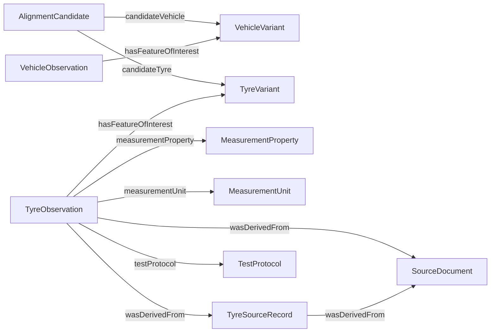

# AutoEcoKG — Automotive Environmental Knowledge Graph

    

**AutoEcoKG** is a graph-native automotive environmental analytics and research decision-support system built with **OWL, RDFLib, SPARQL, SHACL, and Streamlit**. Developed for the *Creation and Application of Knowledge Graphs* course, M.Sc. Computer Science, Leibniz University Hannover, it integrates automotive specifications, declared and independently tested energy consumption, carbon emissions, tyre abrasion, safety assessments and measurement provenance.

Unlike conventional automotive comparison tools that present isolated tabular specifications, AutoEcoKG represents vehicle variants, tyre variants, measurements, alignment candidates, test protocols and source documents as an interconnected semantic network.

1. **Vehicle Environmental Intelligence:** Compare combustion-engine, hybrid and electric vehicle variants using declared WLTP and independently tested ADAC measurements. Explore consumption discrepancies, CO₂ metrics and technical specifications with explicit units and measurement contexts.
2. **Multi-Hop Vehicle–Tyre Analysis:** Traverse vehicle → alignment candidate → tyre → observation → source document paths to investigate how reported vehicle equipment relates to independent tyre tests. Preserve identity and fitment uncertainty instead of assuming that shared names or dimensions prove compatibility.
3. **Multi-Criteria Sustainable Tyre Ranking:** Rank eligible tyre variants by measured abrasion and ADAC driving-safety grades using hard constraints, configurable weights, min-max normalization and Pareto analysis.
4. **Provenance-Aware Knowledge Exploration:** Trace measurements to source documents, pages, extracted evidence and test contexts, and derived consumption gaps to their input observations.
5. **Interactive Knowledge Graph Question Answering (KGQA):** Map supported natural-language question templates to SPARQL queries; return graph-grounded answers with query transparency and optional filters.
6. **Semantic Validation and Benchmark Evaluation:** Validate RDF structure with SHACL and supplementary integrity checks; evaluate query correctness, ranking correctness, known answers and invalid input handling with 37 automated tests.
7. **Interactive Research Dashboard V2:** Explore and compare vehicles, search tyre candidates, adjust environmental preferences, inspect graph nodes, execute SPARQL and review validation results through ten Streamlit pages.

> **Scope:** Academic research prototype, not a certified tyre-fitment, vehicle approval, purchase or installation service. Results describe the included ADAC test snapshot, not the entire German automotive market. EEA and TÜV data are not integrated. The benchmark badge reflects the locally executed snapshot reported below, not a live CI status.

## Table of contents

- [Project objectives and research questions](#project-objectives-and-research-questions)
- [Dataset and sources](#dataset-and-sources)
- [System architecture](#system-architecture)
- [Technology stack](#technology-stack)
- [Ontology namespace and semantic model](#ontology-namespace-and-semantic-model)
- [Data engineering and entity resolution](#data-engineering-and-entity-resolution)
- [Recommendation methodology](#recommendation-methodology)
- [SPARQL query engine](#sparql-query-engine)
- [Advanced dashboard V2](#advanced-dashboard-v2)
- [Repository structure](#repository-structure)
- [Installation and reproducibility](#installation-and-reproducibility)
- [Validation and benchmark evaluation](#validation-and-benchmark-evaluation)
- [Demonstration and troubleshooting](#demonstration-and-troubleshooting)
- [Limitations and future work](#limitations-and-future-work)
- [Data rights and academic attribution](#data-rights-and-academic-attribution)
- [Appendix A — Complete SPARQL catalogue](#appendix-a--complete-sparql-catalogue)
- [Appendix B — Complete benchmark catalogue](#appendix-b--complete-benchmark-catalogue)
- [Appendix C — Vehicle source inventory](#appendix-c--vehicle-source-inventory)

## Project objectives and research questions

Vehicle specifications, tyre tests and environmental performance measurements often appear in separate documents, with different units, terminology and measurement protocols. AutoEcoKG investigates whether an explicit semantic representation can make these sources easier to integrate, compare and audit.

| Research question | Implemented mechanism |
| --- | --- |
| What vehicle variants and powertrains are represented? | RDF entity catalogue and SPARQL selection |
| How do official WLTP and independent ADAC consumption values differ? | Contextualized observations and derived percentage gaps |
| Which recorded vehicles have the lowest declared CO₂? | `vehicle_co2` query; declared values only |
| Which independently tested tyre variants exhibit low abrasion? | `low_abrasion` query with numerical ordering |
| Which tyres combine low abrasion with acceptable safety grades? | Cross-source join, safety threshold, dimension/season filters, weighted ranking |
| Which reported vehicle tyres match tyre-test models and dimensions? | Explicit alignment candidate nodes with match type and verification flags |
| Where did a measurement come from? | SOSA-style observations, PROV-O derivation links and source evidence |
| Can query answers and rankings be reproduced? | SHACL, reference CSV comparisons and independently calculated benchmark rankings |

## Dataset and sources

### Locally validated snapshot (November 2026)

| Metric | Count / result |
| --- | ---: |
| RDF triples (ontology + instances) | 26,834 |
| Vehicle variants | 26 |
| Vehicle observations | 632 |
| Extracted vehicle observations | 609 |
| Derived vehicle consumption-gap observations | 23 |
| Comparable fuel-gap records | 15 |
| Comparable electricity-gap records | 8 |
| Provisional tyre entities | 162 |
| Tyre observations (numeric and textual) | 1,170 |
| Total vehicle and tyre observations | 1,802 |
| Tyre source records | 194 |
| Physical abrasion records | 160 |
| Detailed tyre grading records | 34 |
| Cross-source exact normalized tyre matches | 32 |
| Unresolved tyre alias candidates | 2 |
| Vehicle–tyre alignment candidates | 161 |
| Source document entities | 28 |
| Test protocol entities | 4 |
| SHACL conformity | True |
| Supplementary KG validation errors | 0 |
| KG review warnings | 2 |
| Benchmark pass rate | 37/37 (100%) |

The 194 source rows are not 194 distinct tyre models. A source row can contribute multiple observations, and 32 normalized tyre entities occur in both tyre sources. The two ambiguous matches are retained separately, yielding 162 provisional entities. The 28 source-document entities represent 26 vehicle report text extracts (derived from the original PDFs) and two tyre PDF sources.

### Data sources and scope

| Source | Local input | Content / coverage |
| --- | --- | --- |
| [ADAC Autotest / Autokatalog](https://www.adac.de/rund-ums-fahrzeug/autokatalog/) | `data/raw/adac/*.pdf` | 26 individual passenger-car tests; vehicle specs, declared values and independent test observations |
| ADAC, *Reifenabrieb in der Umwelt: Ergebnisse aus dem ADAC Reifentest und künftige Gesetzgebung* (June 2025) | `data/raw/tyres/adac_tyre_abrasion_2023_2025.pdf` | Appendix 1: 160 abrasion records, 2023–2025; 21-page PDF |
| ADAC, *Sommerreifen 2025 — Reifentests & Reifentipps*, first edition | `data/raw/tyres/adac_summer_tyres_2025.pdf` | 34 summer tyre grading records; 23-page PDF |
| [ADAC tyre tests](https://www.adac.de/rund-ums-fahrzeug/ausstattung-technik-zubehoer/reifen/reifentest/) | Publisher reference | Context and source acquisition |
| [EEA passenger-car CO₂ monitoring](https://www.eea.europa.eu/en/datahub) | `data/raw/eea/` | Planned official registration/CO₂ data; not incorporated because retrieval failed |
| TÜV inspection data | `data/raw/tuv/` | Reserved for future work; no TÜV records in current graph |

The project retains local source filenames and evidence; Appendix C lists the 26 report identities and expected PDF filenames inferred from their extracted text filenames. Direct per-report download URLs and original PDF checksums have not been fully recorded. Obtain the exact source editions from ADAC; do not substitute a generic test-methodology PDF for a vehicle report.

### Vehicle powertrain coverage

| Powertrain key | Vehicle variants |
| --- | ---: |
| `electric` | 8 |
| `diesel` | 6 |
| `petrol_mild_hybrid` | 4 |
| `plug_in_hybrid` | 3 |
| `full_hybrid` | 3 |
| `diesel_mild_hybrid` | 1 |
| `petrol` | 1 |
| **Total** | **26** |

The vehicle reports span 2024–2026. The snapshot includes 22 reports using the ADAC protocol dated 01.02.2019 and four using the protocol dated 01.02.2026. Different protocols must not be assumed equivalent.

### Tyre coverage

| Category | Abrasion records | Detailed grading records |
| --- | ---: | ---: |
| Summer | 84 | 34 |
| Winter | 60 | 0 |
| All-season | 16 | 0 |
| **Total** | **160** | **34** |

| Grading cohort | Tyre size | Records |
| --- | --- | ---: |
| 2025 summer test | 225/40 R18 | 18 |
| 2024 summer test | 215/55 R17 | 16 |

Only the two summer cohorts have detailed safety grades in this snapshot. The graph does not invent missing winter or all-season safety grades.

### Measurement families

| Family | Implemented observations / attributes | Typical units |
| --- | --- | --- |
| Vehicle identity | Vehicle name, powertrain, report date, ID | Text |
| Engine / drivetrain | Power, torque, displacement, drive type, gearbox | kW, PS, Nm, cm³, text |
| Energy | WLTP and ADAC fuel/electricity consumption, city/rural/autobahn values, comparable gaps | L/100 km, kWh/100 km, % |
| CO₂ | Declared WLTP, ADAC reported CO₂, ADAC well-to-wheel CO₂ | g/km |
| Vehicle performance | Mass, top speed, acceleration, braking distance, range, interior noise | kg, km/h, s, m, km, dB(A) |
| Vehicle components | Standard and tested tyre sizes, tested tyre model, suspension comfort | Text, ADAC grade |
| Tyre identity | Name, normalized size, seasonal category | Text |
| Tyre environment | Measured abrasion, estimated UNECE index, environmental, efficiency, mileage, abrasion and sustainability grades | mg/km/t, dimensionless, grade |
| Tyre safety | Driving safety, dry/wet performance, braking, handling, aquaplaning and related grades | ADAC grade |
| EU tyre label | Fuel-efficiency class, wet-grip class, external noise | Text, dB |

**Important semantic distinctions:** physical tyre abrasion is not an abrasion grade; mileage grades are not measured lifespan in kilometres; tyre braking grades are not braking distances in metres; suspension comfort is not suspension strength. Declared tailpipe CO₂ and ADAC well-to-wheel CO₂ are not interchangeable, and neither establishes a complete vehicle lifecycle footprint. NOx, CO, HC and particulate emissions are not comprehensively extracted in this version.

## System architecture


AutoEcoKG generates a provenance-aware RDF/OWL Knowledge Graph locally in Turtle format, supports in-memory SPARQL query execution through RDFLib, and enables semantic inspection using Protégé.

The Streamlit V2 dashboard provides interactive vehicle comparisons, multi-hop vehicle–tyre exploration, multi-criteria tyre recommendations, Pareto analysis and template-based knowledge graph question answering.

Data integrity is assessed through SHACL constraints, Python-based validation and 37 automated benchmark tests. Validation and benchmark reports are generated locally and displayed within the dashboard.

The system operates entirely locally, without requiring an external graph database, LLM API, embedding service or hosted backend.

## Technology stack

| Layer | Technology |
| --- | --- |
| Implementation | Python, standard-library CSV/regex/hashlib/decimal/argparse |
| PDF extraction | PyMuPDF (`fitz`), layout-aware tyre table extraction |
| Graph / ontology | RDF, RDFS, OWL, Turtle, RDFLib |
| Semantic reuse | SOSA and PROV-O; XSD literals |
| Validation | PySHACL and explicit Python audits |
| Querying | SPARQL through `rdflib.Graph.query` |
| Decision support | Deterministic weighted min-max scoring and Pareto dominance |
| Interface | Streamlit, pandas, Plotly; optional Streamlit theme |
| Ontology exploration | Protégé Desktop (optional) |
| Evaluation | Custom Python benchmark, local CSV reference data and reference calculations |
| Version control | Git and GitHub |

The checked-in `requirements.txt` records the local dependency snapshot. The main runtime components include PyMuPDF, RDFLib, PySHACL, pandas, Plotly and Streamlit. Other installed dependencies are not necessarily used by the current pipeline. OWL 2 DL profile compliance and reasoner consistency have not been independently established by this benchmark; no such claim is made.

## Ontology namespace and semantic model

### Namespace identifiers

| Item | IRI / value |
| --- | --- |
| Ontology namespace | `https://w3id.org/autoecokg/ontology#` |
| Ontology prefix | `aek:` |
| Ontology IRI | `https://w3id.org/autoecokg/ontology#AutoEcoKG` |
| Instance/resource namespace | `https://w3id.org/autoecokg/resource/` |
| Resource prefix | `res:` |
| Schema (TBox) | [`ontology/autoecokg_ontology.ttl`](ontology/autoecokg_ontology.ttl) |
| Constraint graph | [`ontology/shacl_shapes.ttl`](ontology/shacl_shapes.ttl) |
| Generated schema + instances (TBox + ABox) | `data/autoecokg_triples.ttl` (local) |

These IRIs identify semantic resources. A public w3id redirect has not been verified or registered as part of this implementation; an IRI need not resolve online for local RDFLib querying.

```turtle
@prefix aek:  <https://w3id.org/autoecokg/ontology#> .
@prefix res:  <https://w3id.org/autoecokg/resource/> .
@prefix rdf:  <http://www.w3.org/1999/02/22-rdf-syntax-ns#> .
@prefix rdfs: <http://www.w3.org/2000/01/rdf-schema#> .
@prefix owl:  <http://www.w3.org/2002/07/owl#> .
@prefix sosa: <http://www.w3.org/ns/sosa/> .
@prefix prov: <http://www.w3.org/ns/prov#> .
@prefix xsd:  <http://www.w3.org/2001/XMLSchema#> .
@prefix sh:   <http://www.w3.org/ns/shacl#> .
```

### Main classes

| Class | Purpose | Snapshot individuals |
| --- | --- | ---: |
| `aek:VehicleVariant` | Specific reported vehicle configuration | 26 |
| `aek:TyreVariant` | Provisional tyre name-size-season identity | 162 |
| `aek:VehicleObservation` | Extracted or derived vehicle property | 632 |
| `aek:TyreObservation` | Tyre measurement, grade or label | 1,170 |
| `aek:TyreSourceRecord` | Original abrasion or grading row; added/declared by graph generator | 194 |
| `aek:AlignmentCandidate` | Vehicle-to-tyre match with uncertainty | 161 |
| `aek:TyreAliasCandidate` | Potential cross-source tyre identity match | 2 |
| `aek:SourceDocument` | Source filename reference | 28 |
| `aek:TestProtocol` | Test methodology context | 4 |
| `aek:MeasurementProperty` | Controlled measured-property concepts | Shared vocabulary |
| `aek:MeasurementUnit` | Controlled units | Shared vocabulary |

`VehicleObservation` and `TyreObservation` are subclasses of `sosa:Observation`. `TyreSourceRecord` is a subclass of `prov:Entity` in the generated graph. The generator also declares source table column, text checksum and report-date properties. This is vocabulary reuse, not a claim of fully imported external ontologies.

### Key relationships and attributes

| Predicate | Role |
| --- | --- |
| `rdf:type`, `rdfs:label`, `aek:recordId` | Class membership, human-readable label and record ID |
| `sosa:hasFeatureOfInterest` | Observation or tyre source row → vehicle/tyre |
| `sosa:observedProperty`, `aek:measurementProperty` | Observation → measured property |
| `aek:numericValue`, `aek:textValue` | Decimal numerical result or text result |
| `aek:measurementUnit` | Numeric observation → unit |
| `aek:measurementContext` | Declared, independent ADAC, grade, EU label, or derived context |
| `aek:testProtocol`, `aek:testYear`, `aek:testPeriod` | Test methodology and temporal metadata where supplied |
| `prov:wasDerivedFrom` | Observation → source document/source row or derived observation → input observations |
| `aek:sourceFilename`, `aek:sourcePage`, `aek:sourceLine`, `aek:sourceEvidence` | Source traceability (where available) |
| `aek:sourceTableColumn`, `aek:sourceTextSha256`, `aek:reportDate` | Additional evidence/reproducibility metadata |
| `aek:powertrain`, `aek:testedTyreName`, `aek:testedTyreSize` | Vehicle metadata |
| `aek:tyreSize`, `aek:seasonCategory` | Tyre metadata |
| `aek:candidateVehicle`, `aek:candidateTyre` | Alignment node → vehicle and tyre |
| `aek:matchType`, `aek:identityVerified`, `aek:fitmentVerified` | Match evidence and explicit verification status |
| `aek:aliasSourceTyre`, `aek:aliasTargetTyre`, `aek:reviewStatus` | Unresolved alias candidate |

Numeric measurements use `xsd:decimal` and defined units; text values use `xsd:string`. Verification flags use `xsd:boolean`, source page/line use `xsd:integer`, and tyre test years use `xsd:gYear`. Observation IDs are URI-encoded to retain stable resource identifiers. `%2F` in an observation URI is the encoded slash, not an error.

### Multi-hop semantic pattern



A SPARQL query may traverse the inverse direction of an edge by matching the subject of the predicate. For example, from an Audi A3 vehicle, a query finds an alignment candidate, then its tyre, then observations whose feature of interest is that tyre, and finally the original source. This is a graph join over explicit semantic relationships; it is not a physical simulation or automatically inferred fitment approval.

### Example from the graph

Both Audi A3 Sportback variants (35 TDI and 1.5 TFSI e) have reported test tyres named Nexen N Fera Sport, with size 225/40 R18 92Y. The independent tyre source includes the same model name and basic size, with 75 mg/km/t abrasion and safety grade 2.4. The alignment type is `model_size_match`; both verification flags remain `false`. These values belong to the independent tyre test, not to vehicle-specific measured abrasion on either Audi.

A minimal illustrative RDF pattern (using illustrative identifiers, not an additional dataset):

```turtle
res:exampleTyre a aek:TyreVariant ;
    rdfs:label "Example tyre" ; aek:tyreSize "225/40 R18"^^xsd:string .
res:exampleObservation a aek:TyreObservation ;
    sosa:hasFeatureOfInterest res:exampleTyre ;
    aek:measurementProperty aek:abrasion_mg_km_t ;
    sosa:observedProperty aek:abrasion_mg_km_t ;
    aek:numericValue "75.0"^^xsd:decimal ;
    aek:measurementUnit aek:mgPerKmPerTonne .
```

This fragment illustrates the modelling pattern only; it omits mandatory provenance fields and is not a complete SHACL-conforming fixture.

## Data engineering and entity resolution

### Pipeline scripts and outputs

All script paths below are relative to the repository root. Generated files are local and ignored by Git except folder placeholders.

| Step | Script | Main input | Main output |
| ---: | --- | --- | --- |
| 1 | `src/extract_adac_pdfs.py` | Vehicle PDFs | `data/intermediate/*.txt`, `extraction_summary.csv` |
| 2 | `src/parse_vehicle_data.py` | Extracted vehicle text | Consolidated and normalized vehicle CSVs, provenance, parsing summary |
| 3 | `src/validate_vehicle_data.py` | Vehicle CSVs | Validation issues, summary, completeness |
| 4 | `src/extract_tyre_data.py` | Two tyre PDFs | `data/intermediate/tyres/` raw tables and summary |
| 5 | `src/parse_tyre_data.py` | Raw tyre tables | Normalized tyre entities, observations and alias candidates |
| 6 | `src/validate_tyre_data.py` | Tyre tables | Tyre validation summary/issues |
| 7 | `src/entity_alignment.py` | Vehicle + tyre tables | Candidate links and vehicle coverage summary |
| 8 | `src/generate_knowledge_graph.py` | Processed tables and ontology | `data/autoecokg_triples.ttl` |
| 9 | `src/validate_knowledge_graph.py` | Graph and SHACL shapes | KG validation reports |
| 10 | `src/engine.py` | Graph | SPARQL result rows, optional CSV export |
| 11 | `src/recommendation.py` | Graph through query engine | Ranked tyre candidates, optional CSV export |
| 12 | `src/evaluate.py` | Graph and processed reference tables | `evaluation/benchmark_results.csv`, `benchmark_summary.csv` |
| 13 | `src/app.py` / `src/app_v2.py` | Graph + saved validation/benchmark reports | Interactive dashboard V1 / V2 |

<details>
<summary><strong>Generated file catalogue</strong></summary>

| Directory | File(s) | Description |
| --- | --- | --- |
| `data/intermediate/` | `*.txt`, `extraction_summary.csv` | Extracted vehicle reports and extraction log |
| `data/intermediate/tyres/` | `tyre_abrasion_raw.csv`, `tyre_test_grades_raw.csv`, `tyre_extraction_summary.csv` | Parsed tyre source tables (160 + 34 rows) |
| `data/processed/` | `adac_vehicles.csv`, `vehicles.csv` | Consolidated vehicle data and identity table |
| `data/processed/` | `engine_specs.csv`, `emissions.csv`, `energy_consumption.csv`, `vehicle_components.csv`, `performance.csv` | Domain-specific vehicle tables |
| `data/processed/` | `provenance.csv`, `parsing_summary.csv` | 609 extracted vehicle observations and parser audit |
| `data/processed/` | `validation_issues.csv`, `validation_summary.csv`, `data_completeness.csv` | Vehicle checks and missing-value coverage |
| `data/processed/` | `tyres.csv`, `tyre_abrasion.csv`, `tyre_test_grades.csv` | 162 tyre entities, 160 abrasion records, 34 grade records |
| `data/processed/` | `tyre_provenance.csv`, `tyre_match_candidates.csv`, `tyre_normalization_summary.csv` | 194 source rows, 2 unresolved aliases, normalization summary |
| `data/processed/` | `tyre_validation_issues.csv`, `tyre_validation_summary.csv` | Tyre validation findings |
| `data/processed/` | `vehicle_tyre_matches.csv`, `vehicle_tyre_alignment_summary.csv` | 161 alignment candidates and 26 vehicle summaries |
| `data/` | `autoecokg_triples.ttl` | Populated RDF graph, including schema |
| `data/processed/` | `kg_validation_summary.csv`, `kg_validation_issues.csv`, `kg_shacl_report.ttl`, `kg_shacl_report.txt` | Semantic validation reports |
| `evaluation/` | `benchmark_results.csv`, `benchmark_summary.csv` | 37 individual checks and aggregate summary |
| `evaluation/` | `fuel_gap.csv`, `safe_low_abrasion.csv`, `tyre_recommendations.csv` | Optional CLI exports created by the demonstration commands |

</details>

### Vehicle extraction and context

The pipeline extracts text from the individual ADAC Autotest PDFs, parses reported values and normalizes numeric formatting, and preserves source file, source page, source line and evidence. The parser handles the two report layouts represented in the snapshot. Vehicle identifiers are deterministic, and extracted text SHA-256 values support source change detection. Validation checks the expected fields, units/values and consistency between consolidated records and provenance.

The two protocols dated 01.02.2019 and 01.02.2026 are explicitly recorded for ADAC test observations. Not every report contains every measurement; absence must remain missing, not zero. The original PDF is the authority for any extracted value requiring manual verification.

### Derived energy-consumption gaps

For comparable declared and tested values with a nonzero declared denominator:

```text
consumption_gap_pct = (ADAC_consumption - WLTP_consumption) / WLTP_consumption * 100
```

Fuel and electricity gaps are separate metrics. Positive values indicate the ADAC figure is higher; negative values indicate it is lower. Plug-in hybrid comparisons require special attention to test conditions; the current parser excludes those records from the derived gap calculation. The graph generator links each derived gap to both input observations using `prov:wasDerivedFrom` and does not assign it an invented direct PDF page.

Example from the benchmark: Renault Espace has a declared 4.9 L/100 km and ADAC 6.1 L/100 km, resulting in **24.49%**. It is the largest positive fuel gap among the 15 comparable records in this snapshot, not among all cars in Germany. Independent test consumption is not an everyday owner measurement.

### Tyre table extraction and normalization

The abrasion report and summer guide are extracted separately to avoid mixing physical measurements and grades. The parser checks source layouts and expected counts. Tyre normalization builds a key from normalized name, canonical dimension and season, then derives a stable ID (`TYRE-` plus the first 16 hexadecimal characters of a SHA-256 digest). It case-folds and removes non-alphanumeric characters for the cross-tyre-source key; this improves matching but can collapse meaningful punctuation in future datasets, so model variants need further verification.

The two source tables produce 32 exact normalized overlaps. Two known alias candidates are explicitly flagged instead of merged:

| Abrasion source label | Grading source label | Status |
| --- | --- | --- |
| Syron Premium Performance | Syron Tyres Premium Performance | `manual_review` |
| Doublecoin DC-100 | Double Coin DC-100 (Speed-Index W) | `manual_review` |

Both are 225/40 R18 in the source records. A speed index is additional technical information; matching names and size alone do not establish full variant identity. The original 194 source records remain preserved even if future reviewed matches reduce the provisional entity count.

### Vehicle-to-tyre alignment

The alignment script compares the normalized reported test tyre name and extracted basic dimensions with the independent tyre catalogue. Unlike the cross-source tyre normalization key, its name normalization preserves plus signs and model numbers, so a model such as Primacy 4 is not automatically treated as Primacy 4+ at this stage.

| Match type | Meaning | Links |
| --- | --- | ---: |
| `model_size_match` | Same normalized model and basic tyre dimensions | 2 |
| `model_only` | Same model name, different or unavailable matching dimensions | 7 |
| `dimension_only` | Same basic dimensions, different model name | 152 |
| **Total** | Candidate relationships, not certified fitment | **161** |

| Vehicle coverage | Count |
| --- | ---: |
| At least one model-and-size candidate | 2 |
| Other candidates only | 10 |
| No candidates | 14 |
| Any candidate | 12/26 (46.15%) |

Every candidate stores `identity_verified=false` and `fitment_verified=false`. In the graph these are `aek:identityVerified` and `aek:fitmentVerified`. False means **not verified**, not proven incompatible. Basic dimensions omit many fitment requirements (load index, speed rating, approved wheel combinations and OEM specifications). Measurements cannot be transferred across different tyre sizes merely because names match. No `owl:sameAs` assertion is generated for these uncertain relationships.

## Recommendation methodology

The recommendation engine (`src/recommendation.py`) retrieves abrasion and safety observations using SPARQL, joins them by tyre identity, and applies explicit eligibility filters. It is deterministic multi-criteria decision analysis, not a trained machine-learning model or a safety certification system.

### Hard constraints and soft preferences

| Input | Default | Meaning |
| --- | --- | --- |
| `size` | Required in CLI | Normalized basic tyre dimension, e.g. `225/40 R18` |
| `category` | `summer` | `summer`, `winter`, `all_season` |
| `max_safety` | 2.5 | Maximum accepted ADAC driving-safety grade; lower grades are better |
| `max_abrasion` | None | Optional maximum physical abrasion in mg/km/t; strictly positive, finite |
| `abrasion_weight` | 0.5 | Environmental preference between 0 and 1; safety weight is `1 - abrasion_weight` |

Eligibility requires size and season match, both measurements, finite positive abrasion, and safety grade within the selected range. The abrasion cap excludes candidates above the threshold; weighting changes the ranking of eligible candidates rather than removing them. The cap is a user-defined research constraint, not a Euro 7 regulatory limit.

### Weighted ranking

For each eligible candidate and each criterion `x`, use min-max normalization:

```text
norm(x) = (x - min(x)) / (max(x) - min(x))
score   = w * norm(abrasion) + (1 - w) * norm(safety)
```

If all candidates have the same value for a criterion, its normalized cost is zero. Both criteria are minimized. Lower score is better. Ties are resolved by safety, abrasion and tyre URI, in that order; returned scores are rounded to six decimal places. Conflicting observations for the same tyre are rejected instead of silently overwritten.

A candidate is **Pareto optimal** when no other eligible tyre is at least as good on both abrasion and safety and strictly better on at least one. Pareto flags are computed independently of preference weights within the eligible set.

### Example ranking and abrasion filter impact

For 225/40 R18 summer tyres with maximum safety grade 2.5, no abrasion cap and a 50:50 weight, 11 candidates qualify. The top candidate is Continental Sport Contact 7 (63 mg/km/t, safety grade 1.5, score approximately 0.089744). Michelin Pilot Sport 5 (56 mg/km/t, safety 1.9) ranks first when abrasion weight is 1. The Pareto set is these two tyres. All 11 rows have `fitment_status=not_verified`.

| Abrasion cap (mg/km/t) | Eligible tyres in this example |
| --- | ---: |
| None | 11 |
| 90 | 9 |
| 80 | 7 |
| 70 | 4 |
| 60 | 1 |
| 50 | 0 |

At cap 70, the remaining candidates are Michelin Pilot Sport 5, Falken Azenis FK520, Continental Sport Contact 7 and Bridgestone Potenza Sport. The balanced top candidate changes to Michelin Pilot Sport 5 because the eligible-set normalization bounds change. Scores are **not directly comparable across different filters**. A zero-result query indicates insufficient eligible data under the chosen criteria, not that no safe or suitable tyres exist in the market.

### CLI examples

```powershell
python src/recommendation.py --size "225/40 R18" --limit 0
python src/recommendation.py --size "225/40 R18" --abrasion-weight 1
python src/recommendation.py --size "225/40 R18" --abrasion-weight 0
python src/recommendation.py --size "225/40 R18" --max-safety 2.5 --max-abrasion 70
python src/recommendation.py --size "225/40 R18" --max-safety 2.0 --max-abrasion 70
python src/recommendation.py --size "215/55 R17" --category summer --limit 0
python src/recommendation.py --size "225/40 R18" --limit 0 --output evaluation/tyre_recommendations.csv
```

Export columns: `rank`, `tyre`, `name`, `size`, `category`, `abrasion`, `safety`, `score`, `pareto_optimal`, `fitment_status`.

## SPARQL query engine

The eight canonical SPARQL queries are defined in the `QUERIES` dictionary in [`src/engine.py`](src/engine.py), with shared `PREFIX` declarations. The query engine loads the Turtle graph and uses RDFLib with a typed decimal initial binding for the safety threshold. The recommendation engine reuses query results, rather than bypassing the graph and reading flat source tables. See Appendix A for the complete query text.

| Query ID | Purpose | Snapshot result rows |
| --- | --- | ---: |
| `vehicles` | Vehicle catalogue and powertrains | 26 |
| `vehicle_co2` | Declared WLTP CO₂ ordered ascending | 26 |
| `fuel_gap` | Declared/tested fuel and derived gap, descending gap | 15 |
| `low_abrasion` | Physical abrasion with size and category | 160 |
| `safe_low_abrasion` | Abrasion + safety cross-source join; threshold binding | 15 at 2.5 |
| `alignment` | All alignment candidates and flags | 161 |
| `matched_tyre_observations` | Model-and-size links joined to abrasion and optional safety | 2 |
| `provenance` | Abrasion observation → document filename and page | 160 |

```powershell
python src/engine.py --list
python src/engine.py --query vehicles --limit 0
python src/engine.py --query vehicle_co2 --limit 0
python src/engine.py --query fuel_gap --limit 0
python src/engine.py --query low_abrasion --limit 10
python src/engine.py --query safe_low_abrasion --max-safety 2.5 --limit 0
python src/engine.py --query alignment --limit 0
python src/engine.py --query matched_tyre_observations
python src/engine.py --query provenance --limit 5
python src/engine.py --query safe_low_abrasion --output evaluation/safe_low_abrasion.csv
python src/engine.py --query fuel_gap --output evaluation/fuel_gap.csv
```

The CLI shows the first ten rows by default; `--limit 0` displays every row. Exports include all matching rows, independent of display limit. `--graph PATH` allows a different generated graph. Query execution uses an in-memory graph and is not a public SPARQL endpoint. No universal latency guarantee is asserted.

## Advanced dashboard V2

Run [`src/app_v2.py`](src/app_v2.py) for the current advanced interface. The original seven-page `src/app.py` remains available as V1. The committed `.streamlit/config.toml` provides optional theme configuration.

### Ten interactive sections

| Page | Implemented functionality |
| --- | --- |
| Overview | RDF counts, powertrain/abrasion category charts, alignment coverage |
| Vehicle explorer | Powertrain and vehicle selection; measured specifications, source evidence, WLTP CO₂ and fuel-gap comparison |
| Compare vehicles | Select up to four vehicles, side-by-side metrics, same-unit charts, separate fuel/electricity comparisons, source/protocol details, CSV export |
| Tyre explorer | Season and dimension filters, abrasion charts, inspection of all matching entities including grade-only records |
| Vehicle-based tyre search | Choose a vehicle, filter alignment types, join independent abrasion and safety evidence, inspect candidate measurements |
| Tyre recommendations | Season, dimension, safety threshold, environmental weight, optional abrasion cap, counts before/after filter, exclusion table, Pareto scatter, ranked results, source evidence and score explanation |
| Graph explorer | Vehicle and match filters, bounded interactive Plotly graph, selectable nodes and observation inspector |
| Ask AutoEcoKG | Eight supported natural-language templates, controlled filters, answer tables and query transparency |
| SPARQL queries | Built-in query selection, safety parameter binding, SPARQL source display and CSV export |
| Validation & benchmarks | Saved SHACL summary/issues and benchmark records with category filtering |

The app caches graph/query/ranking results using Streamlit and the graph file modification time. RDFLib query access in the cached helpers is protected by a lock. The graph diagram shows a selected subset (up to 12 links); the table retains the full selected candidate set. Plotly selection has a manual node-selection fallback for older Streamlit versions. The graph explorer visualizes explicit candidate nodes, not certified relationships.

### Ask AutoEcoKG: supported questions

| Natural-language template | Query |
| --- | --- |
| Which vehicles have the lowest declared WLTP CO₂? | `vehicle_co2` |
| Which diesel car has the lowest ADAC fuel consumption among comparable records? | `fuel_gap` |
| Which vehicles have the largest fuel consumption gap? | `fuel_gap` |
| Which tyres have the lowest abrasion? | `low_abrasion` |
| Which tyres meet a safety grade threshold and have low abrasion? | `safe_low_abrasion` |
| Which vehicles have model-and-size tyre matches? | `matched_tyre_observations` |
| Where do the tyre abrasion measurements come from? | `provenance` |
| Which vehicles and powertrains are in the graph? | `vehicles` |

The user can select a template or enter its supported wording (case-insensitive, with optional trailing question mark). Unsupported questions are rejected. The diesel question filters comparable fuel-gap records to the exact `diesel` category and orders them by ADAC fuel consumption; it does not include diesel mild hybrids. Tyre-size filtering is applied to returned rows when selected. The app shows the underlying SPARQL and relevant filters. This is **template-based KGQA**, not unrestricted free-text-to-SPARQL or LLM-based generation.

### Screenshots

Dashboard screenshots can be added under `visualizations/` after reviewing whether they disclose third-party test data. The repository currently has only a placeholder there; no screenshot is linked until an actual permitted image is committed. V1 has been opened locally in Streamlit; V2 is implemented and checked into the repository, but the 37-test benchmark is a backend benchmark, not a full browser UI test suite.

## Repository structure

```text
AutoEcoKG/
├── .gitignore
├── .streamlit/
│   └── config.toml
├── README.md
├── requirements.txt
├── data/                          # Local datasets; tracked placeholders only
│   ├── raw/
│   │   ├── adac/                  # 26 vehicle PDFs (local)
│   │   ├── tyres/                 # Two tyre PDFs (local)
│   │   ├── eea/                   # Reserved; not integrated
│   │   ├── tuv/                   # Reserved; not integrated
│   │   └── methodology/           # Optional source methodology archive
│   ├── intermediate/              # Extracted text and tyre tables
│   ├── processed/                 # Validated CSVs and reports
│   └── autoecokg_triples.ttl       # Generated locally; not tracked
├── ontology/
│   ├── autoecokg_ontology.ttl
│   └── shacl_shapes.ttl
├── src/
│   ├── extract_adac_pdfs.py
│   ├── parse_vehicle_data.py
│   ├── validate_vehicle_data.py
│   ├── extract_tyre_data.py
│   ├── parse_tyre_data.py
│   ├── validate_tyre_data.py
│   ├── entity_alignment.py
│   ├── generate_knowledge_graph.py
│   ├── validate_knowledge_graph.py
│   ├── engine.py
│   ├── recommendation.py
│   ├── evaluate.py
│   ├── app.py                     # Original dashboard
│   └── app_v2.py                  # Advanced dashboard
├── evaluation/                    # Local benchmark and query exports
├── queries/                       # Placeholder; canonical queries in engine.py
├── tests/                         # Placeholder; benchmark in evaluate.py
├── report/                        # Placeholder for academic report
└── visualizations/                # Placeholder for diagrams/screenshots
```

Git tracks files rather than empty directories. The `.gitkeep` placeholders retain the folder structure while third-party source data, extracted content, generated RDF and evaluation exports stay local. The checked-in code, ontology, shapes, dependency configuration and README are sufficient to inspect the implementation; the actual source files are required to recreate the populated graph.

## Installation and reproducibility

### Prerequisites

- Python version compatible with the pinned dependencies in `requirements.txt`.
- Git, terminal (PowerShell on Windows), and a browser.
- The exact ADAC source reports described above; local disk access.
- Optional: Protégé Desktop for OWL/Turtle inspection.

### 1. Clone and install

```powershell
git clone https://github.com/YASH123H/AutoEcoKG.git
cd AutoEcoKG
python -m venv .venv
.\.venv\Scripts\Activate.ps1
python -m pip install -r requirements.txt
```

If continuing an existing clone, do not clone again or recreate the working environment unnecessarily. On macOS/Linux, the virtual environment activation command is `source .venv/bin/activate`. Run subsequent commands from the repository root; the extraction and alignment scripts may use relative paths. Verify dependency installation with:

```powershell
python -m pip show pymupdf rdflib pyshacl pandas plotly streamlit
```

### 2. Download or place source files

Download all 28 exact ADAC source reports automatically:

```powershell
python src/download_raw_data.py
```

Alternatively, manually place the source files:
- Put the 26 individual vehicle Autotest PDFs in `data/raw/adac/`. Do not put methodology-only documents or duplicate PDFs there.
- Put the two tyre PDFs in `data/raw/tyres/` with the exact filenames `adac_tyre_abrasion_2023_2025.pdf` and `adac_summer_tyres_2025.pdf`.
- Keep EEA/TÜV folders empty unless future integration code is developed.

### 3. Rebuild and validate in order

```powershell
python src/extract_adac_pdfs.py
python src/parse_vehicle_data.py
python src/validate_vehicle_data.py
python src/extract_tyre_data.py
python src/parse_tyre_data.py
python src/validate_tyre_data.py
python src/entity_alignment.py
python src/generate_knowledge_graph.py
python src/validate_knowledge_graph.py
python src/evaluate.py
```

Run each step successfully before continuing. Inspect any `FAIL` status, parser error or warning. Do not edit raw observations merely to make validation pass. `PASS_WITH_REVIEW` is expected for the unresolved aliases in the documented snapshot. The generated graph includes both ontology definitions and actual instances; the generator checks Turtle serialization by reading it back and comparing triple counts.

Common alternate input options (see each script's `--help` where available):

```powershell
python src/parse_vehicle_data.py --input data/intermediate --output data/processed
python src/extract_tyre_data.py --input-dir data/raw/tyres --output-dir data/intermediate/tyres
python src/parse_tyre_data.py --input-dir data/intermediate/tyres --output-dir data/processed
python src/validate_tyre_data.py --data data/processed
python src/entity_alignment.py --data data/processed
python src/generate_knowledge_graph.py --input data/processed --ontology ontology/autoecokg_ontology.ttl --output data/autoecokg_triples.ttl
python src/validate_knowledge_graph.py --graph data/autoecokg_triples.ttl --shapes ontology/shacl_shapes.ttl --output data/processed
python src/evaluate.py --graph data/autoecokg_triples.ttl --input data/processed --output evaluation
```

### 4. Launch the application

```powershell
python -m streamlit run src/app_v2.py
```

Open <http://localhost:8501>. Keep the terminal running while using the application. Stop with `Ctrl+C`. To run the original dashboard instead:

```powershell
python -m streamlit run src/app.py
```

The app does not acquire or regenerate the dataset automatically. If the graph or validation reports are missing, run the relevant commands first. A public cloud deployment is not included, and public hosting of data-bearing outputs requires a data rights review.

### 5. Inspect the ontology in Protégé (optional)

Open `ontology/autoecokg_ontology.ttl` to inspect the schema classes and properties. Open `data/autoecokg_triples.ttl` to inspect the populated graph. Use the Entities / Individuals by class views to explore `VehicleVariant`, `TyreVariant`, observations and candidate nodes. An OWL reasoner such as HermiT can separately investigate logical consistency if available; SHACL conformity is not proof of OWL logical consistency or OWL 2 DL compliance.

## Validation and benchmark evaluation

### Validation layers

| Layer | Checks |
| --- | --- |
| Vehicle extraction/parser audit | Identity, required fields, measurement context, completeness and provenance consistency |
| Tyre normalization/validation | Unique IDs, basic dimension format, category, finite positive abrasion, grades in 0.6–5.5, source rows and unresolved aliases |
| Alignment integrity | Valid entity references and conservative verification flags |
| Turtle round-trip | Generated graph serializes and parses again |
| SHACL | Record identifiers, feature classes, observation property and unit structure, numeric/text exclusivity, source links, candidate and alias shapes |
| Supplementary Python graph audit | ID uniqueness, observation values, provenance, derived gap calculations, unsupported identity/fitment claims and unresolved aliases |
| Benchmarks | Exact result multiset comparisons, order, reference ranking, known answers and negative tests |

The current local KG result is `PASS_WITH_REVIEW`: SHACL conforms, zero critical errors and two warnings for unresolved tyre aliases. These warnings are not suppressed, and the graph does not merge the aliases. The SHACL report and supplementary issues are saved locally. SHACL checks expected graph constraints; it does not verify all original PDF measurements or guarantee factual correctness outside the sample.

### Benchmark design

All 37 checks are defined in the `evaluate()` function of [`src/evaluate.py`](src/evaluate.py), using `case(group, question, fn)`. The tests receive IDs `CQ-01` through `CQ-37` in registration order. The eight actual reusable SPARQL queries are in `src/engine.py`, not 37 separate query files. The `queries/` and `tests/` folders currently contain placeholders. Appendix B documents every registered check.

| Category | Tests | Passed in local snapshot |
| --- | ---: | ---: |
| SPARQL query correctness (`query`) | 19 | 19 |
| Recommendation correctness (`recommendation`) | 9 | 9 |
| Known-answer checks (`anchor`) | 4 | 4 |
| Invalid input handling (`negative`) | 5 | 5 |
| **Total** | **37** | **37** |

The benchmark compares returned rows with reference multisets built from the processed CSVs, including identities, expected measurements and duplicate/missing/unexpected rows. It recomputes fuel gaps independently from their inputs and computes a separate CSV-based reference ranking without calling the recommender or SPARQL. The ranking checks compare ordered candidates, scores, flags and ranks. Known-answer checks guard specific findings from regression. Negative tests confirm invalid input rejection and empty-result behavior is tested in recommendation cases.

```powershell
python src/evaluate.py
Import-Csv evaluation/benchmark_summary.csv | Format-List
Import-Csv evaluation/benchmark_results.csv | Format-Table test_id,group,status,elapsed_ms
```

Expected summary for the documented snapshot:

```text
rdf_triples: 26834
total_tests: 37
passed: 37
failed: 0
pass_rate_pct: 100.0
```

The saved CSV contains `test_id`, `group`, `question`, `status`, `detail`, and `elapsed_ms`. The benchmark caches repeated query/ranking calls; per-test durations therefore mix initial execution and cached checks. They are not a controlled SPARQL latency benchmark. No sub-10-ms performance claim is made. The benchmark measures correctness relative to the same processed dataset (regression testing), not independently audited source ground truth, model generalization or accuracy across the market. It does not test browser UI interactions or a reasoner's OWL consistency. When source data changes, review and update the known-answer fixtures deliberately rather than forcing a pass.

## Demonstration and troubleshooting

### Suggested demonstration sequence

1. Start V2 and show the Overview (26 vehicles, 162 provisional tyres, 26,834 triples).
2. Compare Renault Espace and Toyota Yaris; explain declared/tested consumption and why context matters.
3. Open the vehicle-based tyre search for either Audi A3; inspect the model-and-size Nexen candidate and independent tyre observations.
4. Show tyre recommendation for 225/40 R18 summer tyres, safety grade 2.5 and no cap. The default balanced ranking has 11 candidates and two Pareto-optimal results. Change the abrasion weight to 100% and observe the different first result. Enable a 70 mg/km/t cap to show four eligible candidates and the exclusion table.
5. Use Graph explorer to inspect an alignment node, tyre node and its observation evidence.
6. In Ask AutoEcoKG, ask a supported question and reveal its SPARQL query. Demonstrate that unsupported wording is rejected.
7. In Validation & benchmarks, show SHACL conformity, the two unresolved alias warnings and the 37/37 benchmark result. Explain what the benchmark does and does not establish.

### Troubleshooting

| Symptom | Action |
| --- | --- |
| PDF parser returns no vehicle records | Confirm actual Autotest PDFs are present, extract them first, inspect `extraction_summary.csv` and `parsing_summary.csv` |
| Tyre extraction fails | Check exact PDF names, editions and expected layouts; do not silently change expected row counts |
| `ModuleNotFoundError` | Activate the correct `.venv` and install `requirements.txt` with `python -m pip` |
| Graph missing in app | Run `python src/generate_knowledge_graph.py` after successful upstream processing |
| SHACL does not conform | Read `kg_shacl_report.txt` and `kg_validation_issues.csv`; fix underlying data or modelling issue |
| Only ten results in terminal | Use `--limit 0`; CLI export still contains all rows |
| Winter/all-season recommendation is empty | Current detailed safety-grade dataset covers two summer dimensions only |
| No vehicle alignment candidates | Current tyre test coverage is limited; absence is not evidence of incompatibility |
| `fitment_status=not_verified` | Expected research safeguard, not an error |
| Theme not applied | Confirm `.streamlit/config.toml` is named exactly and restart Streamlit |
| Node click does not select | Use the graph node dropdown; check Streamlit version and Plotly selection support |
| GitHub lacks local datasets | Expected: source data and generated outputs are excluded pending redistribution permission |

## Limitations and future work

### Current limitations

- Coverage: 26 vehicle reports and 160 physical tyre abrasion records are a selected sample, not the entire market. Detailed tyre safety grades cover only 34 summer records. Only two vehicle reports have model-and-size candidates; 14 have no alignment candidate.
- Source integration: all current source observations originate in ADAC material. EEA official registration data and TÜV inspection data remain unimplemented. The project integrates distinct report types, not independent data publishers.
- Measurement context: different ADAC protocol editions, WLTP definitions, fuel/electricity units and plug-in hybrid test conditions restrict comparisons. No generic conversion between fuel and electricity consumption is assumed. CO₂ metrics are not a complete lifecycle assessment.
- Environmental scope: tyre mass loss is not exclusively airborne particulate matter; normalized independent tyre abrasion cannot establish vehicle-specific emissions. Estimated UNECE indices are not type approval or regulatory certification.
- Identity: two alias candidates remain unresolved. Normalized name-size-season keys omit some variant information and may collapse punctuation distinctions in future datasets. Vehicle alignment does not verify OEM version, load rating, speed rating or certified fitment.
- Provenance: report text checksums and page references are preserved, but a complete acquisition manifest with per-PDF URL, edition and original-file checksums is still needed. Extraction quality is not independently validated by the benchmark.
- Recommendation: only complete eligible records are ranked; min-max scores depend on candidate set and selected weights. No price, verified fitment, actual mileage or additional objective is optimized unless added explicitly in a future version.
- KGQA: eight supported templates; no general natural-language understanding or unrestricted SPARQL generation.
- Evaluation: the 37 passing tests concern the current dataset and backend behavior. No independent external gold standard, controlled latency benchmark, formal OWL profile verification or full UI regression suite is claimed.
- Reproducibility: source layouts and editions matter. The clone contains code and placeholders, not the actual third-party data, so a new user must obtain source documents to regenerate the graph.

### Proposed future work (not implemented)

| Priority | Extension |
| --- | --- |
| High | Resolve the Syron and Doublecoin aliases against full test variant specifications and extend identity keys |
| High | Extend tyre safety-grade coverage to additional dimensions, winter and all-season cohorts |
| High | Record a complete lawful source acquisition manifest with URLs, editions and PDF checksums |
| High | Add official EEA registration CO₂ data once accessible and perform robust vehicle-variant alignment |
| High | Add independent source-level verification and browser acceptance tests for V2 |
| Medium | Add standalone `.sparql` files and versioned competency-question specifications without duplicating query maintenance |
| Medium | Add optional approved-fitment evidence from vehicle type-approval/CoC sources and richer technical identity constraints |
| Medium | Expand provenance, protocol-aware comparisons and standard vocabulary alignment (e.g. QUDT units) |
| Medium | Extend KGQA to broader supported paraphrases with safe, validated query generation |
| Medium | Add controlled query latency benchmarks, OWL reasoning checks and formal profile assessment |
| Medium | Explore additional pollution measurements, lifecycle sources and TÜV data where available |
| Medium | Publish permitted screenshots, academic report, ontology diagrams and a reproducible synthetic demo dataset |

## Data rights and academic attribution

This project is an academic prototype developed for the M.Sc. Computer Science course *Creation and Application of Knowledge Graphs* at Leibniz University Hannover. Repository: [YASH123H/AutoEcoKG](https://github.com/YASH123H/AutoEcoKG).

ADAC reports, their extracted text, test evidence and data remain subject to applicable source terms and rights. The presence of a source on a public website does not automatically authorize bulk redistribution. Keep raw PDFs, extracted text, data-bearing CSVs and populated RDF local until appropriate redistribution permissions are established. The README documents aggregate results and selected research examples; review these and any screenshots before public distribution. No code license is asserted here because no repository license file is currently present. Add a code license only after choosing one and distinguishing it from third-party data rights.

References and standards: [ADAC Autokatalog](https://www.adac.de/rund-ums-fahrzeug/autokatalog/), [ADAC tyre tests](https://www.adac.de/rund-ums-fahrzeug/ausstattung-technik-zubehoer/reifen/reifentest/), [EEA Datahub](https://www.eea.europa.eu/en/datahub), [RDF 1.1](https://www.w3.org/TR/rdf11-concepts/), [OWL 2](https://www.w3.org/TR/owl2-overview/), [SPARQL 1.1 Query](https://www.w3.org/TR/sparql11-query/), [SHACL](https://www.w3.org/TR/shacl/), [SOSA/SSN](https://www.w3.org/TR/vocab-ssn/), [PROV-O](https://www.w3.org/TR/prov-o/), [RDFLib](https://rdflib.readthedocs.io/), [Streamlit](https://docs.streamlit.io/) and [Protégé](https://protege.stanford.edu/).

---

## Appendix A — Complete SPARQL catalogue

The following are the eight canonical queries from `src/engine.py`. Shared prefixes are reproduced with each query for readability. `safe_low_abrasion` uses the engine's `maxSafety` initial binding (default 2.5 as `xsd:decimal`); for standalone execution, a `VALUES` clause with the desired threshold is included below. The `queries/` directory does not yet contain separate query files; these are documentation copies of the Python definitions.

<details>
<summary><strong>A.1 — vehicles</strong></summary>

```sparql
PREFIX aek: <https://w3id.org/autoecokg/ontology#>
PREFIX sosa: <http://www.w3.org/ns/sosa/>
PREFIX rdfs: <http://www.w3.org/2000/01/rdf-schema#>
PREFIX prov: <http://www.w3.org/ns/prov#>

SELECT ?vehicle ?name ?powertrain WHERE {
 ?vehicle a aek:VehicleVariant ; rdfs:label ?name ; aek:powertrain ?powertrain .
} ORDER BY ?name
```

</details>

<details>
<summary><strong>A.2 — vehicle_co2</strong></summary>

```sparql
PREFIX aek: <https://w3id.org/autoecokg/ontology#>
PREFIX sosa: <http://www.w3.org/ns/sosa/>
PREFIX rdfs: <http://www.w3.org/2000/01/rdf-schema#>
PREFIX prov: <http://www.w3.org/ns/prov#>

SELECT ?vehicle ?name ?co2 WHERE {
 ?vehicle a aek:VehicleVariant ; rdfs:label ?name .
 ?obs a aek:VehicleObservation ; sosa:hasFeatureOfInterest ?vehicle ;
 aek:measurementProperty aek:wltp_co2_g_km ; aek:numericValue ?co2 .
} ORDER BY ?co2 ?name
```

</details>

<details>
<summary><strong>A.3 — fuel_gap</strong></summary>

```sparql
PREFIX aek: <https://w3id.org/autoecokg/ontology#>
PREFIX sosa: <http://www.w3.org/ns/sosa/>
PREFIX rdfs: <http://www.w3.org/2000/01/rdf-schema#>
PREFIX prov: <http://www.w3.org/ns/prov#>

SELECT ?name ?wltp ?adac ?gap WHERE {
 ?vehicle a aek:VehicleVariant ; rdfs:label ?name .
 ?w sosa:hasFeatureOfInterest ?vehicle ; aek:measurementProperty aek:wltp_fuel_l_100km ; aek:numericValue ?wltp .
 ?a sosa:hasFeatureOfInterest ?vehicle ; aek:measurementProperty aek:adac_fuel_l_100km ; aek:numericValue ?adac .
 ?g sosa:hasFeatureOfInterest ?vehicle ; aek:measurementProperty aek:fuel_l_100km_gap_pct ; aek:numericValue ?gap .
} ORDER BY DESC(?gap) ?name
```

</details>

<details>
<summary><strong>A.4 — low_abrasion</strong></summary>

```sparql
PREFIX aek: <https://w3id.org/autoecokg/ontology#>
PREFIX sosa: <http://www.w3.org/ns/sosa/>
PREFIX rdfs: <http://www.w3.org/2000/01/rdf-schema#>
PREFIX prov: <http://www.w3.org/ns/prov#>

SELECT ?tyre ?name ?size ?category ?abrasion WHERE {
 ?tyre a aek:TyreVariant ; rdfs:label ?name ; aek:tyreSize ?size ; aek:seasonCategory ?category .
 ?obs a aek:TyreObservation ; sosa:hasFeatureOfInterest ?tyre ;
 aek:measurementProperty aek:abrasion_mg_km_t ; aek:numericValue ?abrasion .
} ORDER BY ?abrasion ?name ?size
```

</details>

<details>
<summary><strong>A.5 — safe_low_abrasion</strong></summary>

```sparql
PREFIX aek: <https://w3id.org/autoecokg/ontology#>
PREFIX sosa: <http://www.w3.org/ns/sosa/>
PREFIX rdfs: <http://www.w3.org/2000/01/rdf-schema#>
PREFIX prov: <http://www.w3.org/ns/prov#>

SELECT ?tyre ?name ?size ?abrasion ?safety WHERE {
 VALUES ?maxSafety { 2.5 }
 ?tyre a aek:TyreVariant ; rdfs:label ?name ; aek:tyreSize ?size .
 { SELECT ?tyre ?abrasion WHERE { ?a aek:measurementProperty aek:abrasion_mg_km_t ; sosa:hasFeatureOfInterest ?tyre ; aek:numericValue ?abrasion . } }
 { SELECT ?tyre ?safety WHERE { ?s aek:measurementProperty aek:safety_grade ; sosa:hasFeatureOfInterest ?tyre ; aek:numericValue ?safety . } }
 FILTER(?safety <= ?maxSafety)
} ORDER BY ?abrasion ?safety ?name
```

</details>

<details>
<summary><strong>A.6 — alignment</strong></summary>

```sparql
PREFIX aek: <https://w3id.org/autoecokg/ontology#>
PREFIX sosa: <http://www.w3.org/ns/sosa/>
PREFIX rdfs: <http://www.w3.org/2000/01/rdf-schema#>
PREFIX prov: <http://www.w3.org/ns/prov#>

SELECT ?vehicleName ?tyreName ?size ?matchType ?identity ?fitment WHERE {
 ?candidate a aek:AlignmentCandidate ; aek:candidateVehicle ?v ;
 aek:candidateTyre ?t ; aek:matchType ?matchType ;
 aek:identityVerified ?identity ; aek:fitmentVerified ?fitment .
 ?v rdfs:label ?vehicleName .
 ?t rdfs:label ?tyreName ; aek:tyreSize ?size .
} ORDER BY ?matchType ?vehicleName ?tyreName ?size
```

</details>

<details>
<summary><strong>A.7 — matched_tyre_observations</strong></summary>

```sparql
PREFIX aek: <https://w3id.org/autoecokg/ontology#>
PREFIX sosa: <http://www.w3.org/ns/sosa/>
PREFIX rdfs: <http://www.w3.org/2000/01/rdf-schema#>
PREFIX prov: <http://www.w3.org/ns/prov#>

SELECT ?vehicleName ?tyreName ?abrasion ?safety ?identity ?fitment WHERE {
 ?candidate a aek:AlignmentCandidate ; aek:candidateVehicle ?v ;
 aek:candidateTyre ?t ; aek:matchType "model_size_match"^^<http://www.w3.org/2001/XMLSchema#string> ;
 aek:identityVerified ?identity ; aek:fitmentVerified ?fitment .
 ?v rdfs:label ?vehicleName .
 ?t rdfs:label ?tyreName .
 ?a sosa:hasFeatureOfInterest ?t ; aek:measurementProperty aek:abrasion_mg_km_t ; aek:numericValue ?abrasion .
 OPTIONAL { ?s sosa:hasFeatureOfInterest ?t ; aek:measurementProperty aek:safety_grade ; aek:numericValue ?safety . }
} ORDER BY ?vehicleName
```

</details>

<details>
<summary><strong>A.8 — provenance</strong></summary>

```sparql
PREFIX aek: <https://w3id.org/autoecokg/ontology#>
PREFIX sosa: <http://www.w3.org/ns/sosa/>
PREFIX rdfs: <http://www.w3.org/2000/01/rdf-schema#>
PREFIX prov: <http://www.w3.org/ns/prov#>

SELECT ?name ?abrasion ?file ?page WHERE {
 ?t a aek:TyreVariant ; rdfs:label ?name .
 ?obs sosa:hasFeatureOfInterest ?t ; aek:measurementProperty aek:abrasion_mg_km_t ;
 aek:numericValue ?abrasion ; prov:wasDerivedFrom ?doc ; aek:sourcePage ?page .
 ?doc a aek:SourceDocument ; aek:sourceFilename ?file .
} ORDER BY ?name ?abrasion
```

</details>

## Appendix B — Complete benchmark catalogue

The following table documents the 37 checks from the local benchmark export. Each row is a registered test, not necessarily a separate SPARQL query. Results are from the verified November 2026 local snapshot.

| ID | Group | Check | Result |
| --- | --- | --- | --- |
| CQ-01 | query | All vehicle identities, names and powertrains match CSV | PASS |
| CQ-02 | query | Vehicle identifiers are unique | PASS |
| CQ-03 | query | Vehicle list is alphabetically ordered | PASS |
| CQ-04 | query | All WLTP CO2 values and vehicle IDs match CSV | PASS |
| CQ-05 | query | WLTP CO2 ranking is ascending | PASS |
| CQ-06 | query | All fuel gaps match independently recalculated CSV inputs | PASS |
| CQ-07 | query | Fuel gaps are descending | PASS |
| CQ-08 | anchor | Renault Espace has the largest current fuel gap | PASS |
| CQ-09 | query | All abrasion observations match CSV identity and value | PASS |
| CQ-10 | query | Abrasion ordering is ascending | PASS |
| CQ-11 | anchor | Michelin e Primacy is minimum abrasion record | PASS |
| CQ-12 | query | Complete safety-abrasion join at threshold 2.5 | PASS |
| CQ-13 | query | Complete safety-abrasion join at threshold 2.0 | PASS |
| CQ-14 | query | Complete safety-abrasion join at threshold 1.5 | PASS |
| CQ-15 | query | Complete safety-abrasion join at threshold 0.6 | PASS |
| CQ-16 | query | Complete safety-abrasion join at threshold 5.5 | PASS |
| CQ-17 | query | Default joined results sorted by abrasion and safety | PASS |
| CQ-18 | query | All alignment candidates match source CSV | PASS |
| CQ-19 | query | No unsupported fitment or identity confirmation | PASS |
| CQ-20 | query | Model-size match joins return exact vehicles and observations | PASS |
| CQ-21 | anchor | Both Audi A3 matches return Nexen 75 and safety 2.4 | PASS |
| CQ-22 | query | All abrasion provenance document and page values match CSV | PASS |
| CQ-23 | recommendation | Balanced 225/40 R18 ranking matches full reference | PASS |
| CQ-24 | recommendation | Abrasion-only ranking matches full reference | PASS |
| CQ-25 | recommendation | Safety-only ranking matches full reference | PASS |
| CQ-26 | recommendation | Combined safety and abrasion limits match full reference | PASS |
| CQ-27 | recommendation | Alternative 215/55 R17 size matches full reference | PASS |
| CQ-28 | recommendation | Missing winter grading coverage yields no eligible tyres | PASS |
| CQ-29 | recommendation | Unrepresented dimension returns empty list | PASS |
| CQ-30 | recommendation | Impossible abrasion threshold returns empty list | PASS |
| CQ-31 | recommendation | Equivalent ZR size spelling normalizes identically | PASS |
| CQ-32 | anchor | Balanced top tyre and Pareto set match known snapshot | PASS |
| CQ-33 | negative | Invalid weight rejected | PASS |
| CQ-34 | negative | Invalid safety threshold rejected | PASS |
| CQ-35 | negative | Malformed dimension rejected | PASS |
| CQ-36 | negative | Nonpositive abrasion threshold rejected | PASS |
| CQ-37 | negative | Unknown SPARQL query rejected | PASS |

## Appendix C — Vehicle source inventory

This inventory is derived from the current processed vehicle metadata. The expected local PDF filename is inferred by replacing the extracted `.txt` extension with `.pdf`; original filenames should match the extraction manifest. Report dates are preserved as recorded. The table is a source acquisition aid, not a complete URL/checksum manifest.

| Vehicle variant | Expected PDF filename | Report date | ADAC protocol date |
| --- | --- | --- | --- |
| Audi A3 Sportback 1.5 TFSI e advanced S tronic | `Audi A3 Sportback1.5TFSIe.pdf` | August 2025 | 01.02.2019 |
| Audi A3 Sportback 35 TDI advanced S tronic | `AudiA3Sportback_Autotest2.pdf` | September 2024 | 01.02.2019 |
| BMW 520i M Sportpaket Steptronic | `BMW 520i M Sportpaket.pdf` | November 2025 | 01.02.2019 |
| BYD Atto 3 Evo Design | `BYDAtto3EvoDesign.pdf` | 24.11.2026 | 01.02.2026 |
| Honda Civic 2.0 i-MMD e:HEV Elegance | `HondaCivic2.0i.pdf` | 31.07.2026 | 01.02.2026 |
| Hyundai Tucson 1.6 CRDi 48V- Mildhybrid Prime Allrad DCT | `Hyundai Tucson 1.6 CRDi.pdf` | Juni 2025 | 01.02.2019 |
| Hyundai i30 1.5 T-GDI 48V- Mildhybrid Advantage DCT | `Hyundai i30 1.5 T-GDI.pdf` | August 2025 | 01.02.2019 |
| Kia EV3 (58,3 kWh) Earth | `Kia EV3 (58.3 kWh) Earth.pdf` | Mai 2025 | 01.02.2019 |
| Mazda 3 2.5 e-SKYACTIV-G 140 Takumi | `Mazda 3 2.5 e-Skyactiv G 140 Takumi.pdf` | Juli 2025 | 01.02.2019 |
| Mercedes-Benz CLA Coupé 250+ EQ Progressive | `Mercedes-Benz CLA 250+.pdf` | Dezember 2025 | 01.02.2019 |
| Nissan Micra (52 kWh) Evolve | `Nissan Micra 52 kWh Evolve.pdf` | 31.07.2026 | 01.02.2026 |
| Renault Espace E-Tech Full Hybrid 200 Iconic Multi-Mode-Automatik (7-Sitzer) | `Renault Espace E-Tech Full Hybrid 200.pdf` | Dezember 2025 | 01.02.2019 |
| Renault R4 E-Tech Electric 150 Comfort Range (52 kWh) Iconic | `Renault R4 E-Tech Electric 150 Comfort Range.pdf` | Oktober 2025 | 01.02.2019 |
| Renault R5 E-Tech Electric 150 Comfort Range (52 kWh) Techno | `Renault R5 E-Tech Electric 150 Comfort Range.pdf` | April 2025 | 01.02.2019 |
| Skoda Kodiaq 2.0 TDI Selection DSG | `Škoda Kodiaq 2.0 TDI Selection DSG.pdf` | Oktober 2024 | 01.02.2019 |
| Skoda Octavia Combi 1.5 TSI ACT mHEV Selection DSG | `Škoda Octavia Combi 1.5 TSI mHEV Selection DSG.pdf` | Januar 2025 | 01.02.2019 |
| Skoda Octavia Combi 2.0 TDI SCR Selection DSG | `Škoda Octavia Combi 2.0 TDI SCR Selection DSG.pdf` | November 2025 | 01.02.2019 |
| Skoda Superb 2.0 TDI SCR L&K 4x4 DSG | `Škoda Superb 2.0 TDI SCR L&K 4x4 DSG.pdf` | November 2024 | 01.02.2019 |
| Skoda Superb Combi 2.0 TDI SCR Selection 4x4 DSG | `Škoda Superb Combi 2.0 TDI SCR Selection 4x4 DSG.pdf` | Dezember 2024 | 01.02.2019 |
| Skoda Superb Combi 2.0 TDI SCR Selection DSG | `Škoda Superb Combi 2.0 TDI SCR Selection DSG.pdf` | Oktober 2024 | 01.02.2019 |
| Tesla Model 3 | `Tesla Model 3.pdf` | 11.11.2026 | 01.02.2026 |
| Tesla Model Y Maximum Range | `Tesla Model Y Maximum Range.pdf` | November 2025 | 01.02.2019 |
| Toyota Yaris 1.5 Hybrid 130 Style PLUS CVT | `Toyota Yaris 1.5 Hybrid 130 Style PLUS CVT.pdf` | August 2025 | 01.02.2019 |
| VW Golf 1.5 TSI Life | `Volkswagen Golf 1.5 TSI Life.pdf` | Dezember 2024 | 01.02.2019 |
| VW Golf 1.5 eHybrid Style DSG | `Volkswagen Golf 1.5 eHybrid Style DSG.pdf` | Dezember 2025 | 01.02.2019 |
| Volvo XC60 Plug-in Hybrid T6 Ultra Dark AWD Geartronic | `Volvo XC60 T6 Ultra Dark AWD.pdf` | Dezember 2025 | 01.02.2019 |

---

**Project status:** Data engineering, ontology, RDF generation, SHACL validation, SPARQL, tyre recommendation, 37-test benchmark and Streamlit V2 implementation are available. Further source integration, broader coverage, UI acceptance testing and final academic documentation remain ongoing.
