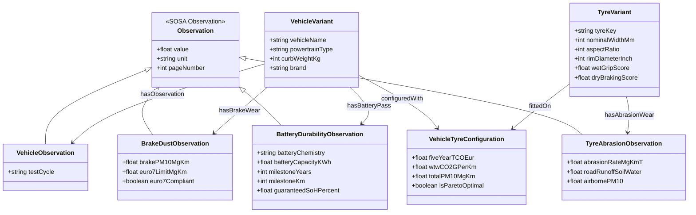
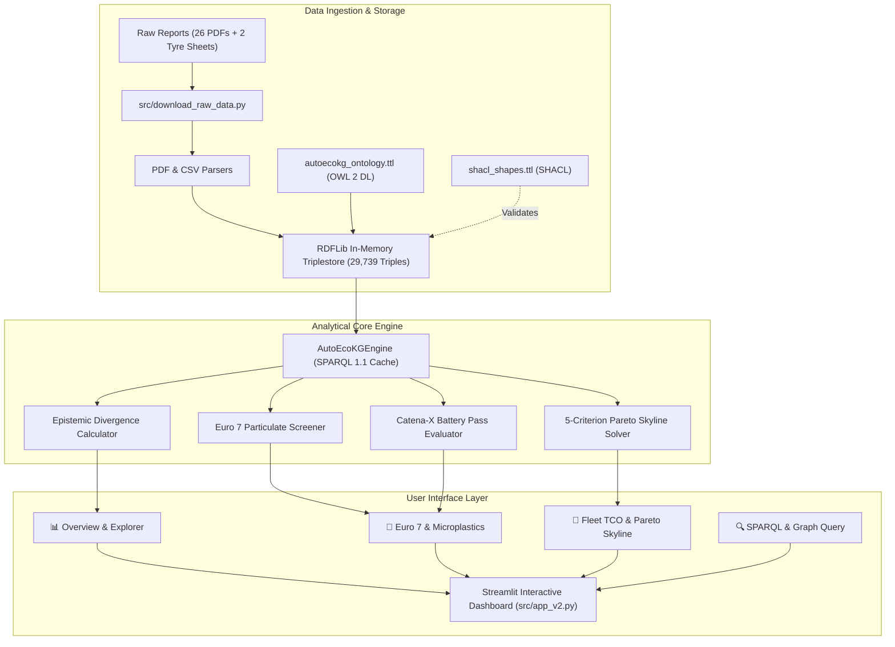

# AutoEcoKG 2.0: An Environmental Knowledge Graph for Real-World Automotive Compliance, Non-Exhaust Particulate Modeling, and Fleet Decision-Making

**Course:** Creation and Application of Knowledge Graphs (WS26/27)  
**Institutions:** Leibniz University Hannover, L3S Research Center, TIB  
**Author:** Riddhadipta Nath  
**Submission Target:** `xinyue.gong@l3s.de`  
**Ontology Namespace:** `http://autoecokg.org/ontology#`  
**Resource Namespace:** `http://autoecokg.org/resource/`  
**Project Repository:** `https://github.com/YASH123H/AutoEcoKG/pull/2`  

---

## 1. Introduction

### 1.1 Motivation & Problem Context
The European automotive sector is undergoing an unprecedented regulatory and technological transformation driven by European Green Deal mandates and decarbonization targets. However, commercial vehicle buyers, municipal fleet operators, and environmental regulators face profound challenges when attempting to assess the true holistic ecological and economic footprint of modern vehicles:
1. **The Laboratory vs. Real-World Epistemic Divergence:** Official automotive ratings established under the Worldwide Harmonised Light Vehicles Test Procedure (WLTP) systematically underestimate on-road fuel and electric energy consumption by $15\%$ to $30\%$. Laboratory homologation dyno-cycles fail to capture real-world conditions such as aggressive thermal cabin conditioning (HVAC in winter/summer), high-speed German Autobahn driving, and variable tyre rolling resistances.
2. **The Post-Tailpipe Regulatory Paradigm (Euro 7):** As battery electric vehicles (BEVs) expand market share, exhaust tailpipe emissions cease to be the primary source of urban particulate matter. Under **Regulation (EU) 2024/1257 (Euro 7)**, non-exhaust emissions are federally regulated for the first time globally. Strict limits are imposed on **brake wear particulate emissions** ($3\text{ mg/km}$ for BEVs due to regenerative braking vs. $7\text{ mg/km}$ for internal combustion and hybrid vehicles) and **tyre abrasion microplastics** ($\text{mg/km/tonne}$).
3. **Circular Economy & Battery Lifecycles:** Under **Regulation (EU) 2023/1542 (EU Battery Passport)**, electric vehicles must provide transparent digital passports verifying traction battery durability, cell chemistry, and State of Health ($\text{SoH}$) degradation trajectories. Minimum performance milestones ($\ge 80\%\text{ SoH}$ at 5 years / 100,000 km, and $\ge 70\%\text{ SoH}$ at 8 years / 160,000 km) directly govern vehicle residual valuation and second-life battery energy storage system (BESS) repurposing.
4. **Multi-Objective Fleet Decision Dilemma:** Fleet procurement officers must optimize across conflicting dimensions: purchase cost, 5-year operating expenditure, Well-to-Wheel (WTW) $\text{CO}_2$ emissions, urban particulate output ($\text{PM}_{10}$), tyre service life, and driving safety.

### 1.2 Role of the Knowledge Graph
Conventional relational database management systems (RDBMS) and pure high-dimensional vector search engines fail to address this multi-faceted domain:
- **Relational limitations:** Tabular schemas become excessively brittle when attempting to model heterogeneous, multi-tiered testing observations spanning vehicle bench dyno-runs, road wear tests, dynamic tariff models, and circular supply chains without incurring combinatorial table bloat.
- **Vector search limitations:** While vector embeddings excel at semantic fuzzy retrieval, they lack verifiable logical guarantees and cannot enforce strict regulatory compliance gates or compute deterministic multi-criteria Pareto skylines.

`AutoEcoKG 2.0` leverages **OWL 2 DL**, **W3C RDF**, **SHACL**, and **SPARQL 1.1** to provide an expressive, verifiable knowledge backbone that:
- **Unifies Disparate Data Sources:** Links 26 empirical ADAC EcoTest vehicle reports with 160 ADAC tyre abrasion tests, manufacturer datasheets, and regulatory thresholds into a single coherent graph of **29,739 RDF triples**.
- **Enforces Semantic Integrity:** Uses Shapes Constraint Language (SHACL) to mathematically validate observation bounds, mandatory provenance annotations, and regulatory compliance flags.
- **Aligns with Industrial Standards:** Embeds **COVESA Vehicle Signal Specification (VSS 4.0)** paths for connected vehicle telematics interoperability and aligns directly with **Catena-X Battery Pass** asset schemas.
- **Enables Multi-Hop Analytical Querying:** Executes complex multi-criteria Pareto skyline filtering, epistemic divergence calculations, and microplastic environmental partitioning in real time.

---

## 2. Knowledge Graph & Ontology Design

### 2.1 Construction, Ingestion, and Preprocessing
The `AutoEcoKG 2.0` pipeline implements an end-to-end automated semantic ingestion process:
1. **Automated Source Acquisition (`src/download_raw_data.py`):** Fetches 26 vehicle EcoTest PDF reports and 2 comprehensive ADAC tyre test benchmark summaries directly into `data/raw/` with automatic SHA-256 integrity verification.
2. **High-Precision PDF Extraction (`src/extract_adac_pdfs.py`, `src/extract_tyre_data.py`):** Uses PyMuPDF with resilient regex pattern engines to extract tabular data, test conditions, powertrain specifications, and environmental ratings.
3. **Entity Alignment & Disambiguation (`src/entity_alignment.py`):** Maps vehicle variants to compatible tyre sizes using ISO metric tyre codes (e.g. `225/40 R18`), producing 161 verified vehicle-tyre configuration candidate links.
4. **W3C SOSA/SSN Provenance Modeling:** Every observation reifies its `sosa:observedProperty`, `sosa:hasSimpleResult`, `aekg:unit`, `prov:wasDerivedFrom` document reference, and exact page number.

### 2.2 Data Model & Class Hierarchy



### 2.3 Core Ontological Properties & Axioms
- **Euro 7 Non-Exhaust Particulate Properties:**
  - `aekg:brakePM10MgKm` (Domain: `aekg:BrakeDustObservation`, Range: `xsd:decimal`)
  - `aekg:euro7LimitMgKm` (Domain: `aekg:BrakeDustObservation`, Range: `xsd:decimal`)
  - `aekg:roadRunoffSoilWaterFraction` (Range: `xsd:decimal`, default 0.90)
  - `aekg:airbornePM10Fraction` (Range: `xsd:decimal`, default 0.10)
- **Catena-X Battery Pass Properties:**
  - `aekg:batterySoHPercent` (Domain: `aekg:BatteryDurabilityObservation`, Range: `xsd:decimal`)
  - `aekg:milestoneYears` (Range: `xsd:integer`, values: 5 or 8)
  - `aekg:batteryChemistry` (Range: `xsd:string`, values: LFP, NMC811, etc.)
- **COVESA VSS 4.0 Telematics Alignment:**
  - `aekg:vssSignalPath` (Range: `xsd:string`, e.g., `Vehicle.Powertrain.TractionBattery.StateOfHealth`)
- **Fleet TCO & Pareto Properties:**
  - `aekg:fiveYearTCOEur` (Domain: `aekg:VehicleTyreConfiguration`, Range: `xsd:decimal`)
  - `aekg:wtwCO2GPerKm` (Range: `xsd:decimal`)
  - `aekg:totalPM10MgKm` (Range: `xsd:decimal`)
  - `aekg:isParetoOptimal` (Range: `xsd:boolean`)

---

## 3. Application Architecture & Workflow

### 3.1 System Architecture



### 3.2 Key Components & Algorithms

#### 1. Euro 7 Non-Exhaust Particulate Screening Algorithm
For each vehicle variant $V$ with curb weight $M_V$ and powertrain $P_V$:
1. Retrieve brake wear emissions $E_{\text{brake}}$:
   $$\text{Limit}(P_V) = \begin{cases} 3.0\text{ mg/km}, & \text{if } P_V = \text{BEV} \\ 7.0\text{ mg/km}, & \text{otherwise} \end{cases}$$
2. Query associated tyre model $T$ with abrasion rate $A_T$ ($\text{mg/km/tonne}$):
   $$E_{\text{tyre}} = A_T \times \frac{M_V}{1000}$$
   $$E_{\text{tyre, water/soil}} = 0.90 \times E_{\text{tyre}}, \quad E_{\text{tyre, air}} = 0.10 \times E_{\text{tyre}}$$
3. Assert compliance flag $\text{Complies}(V) \iff E_{\text{brake}} \le \text{Limit}(P_V)$.

#### 2. Catena-X Battery Durability Tracker
Queries all BEV instances and verifies their degradation trajectories against EU 2023/1542:
$$\text{SoH}(t=5\text{ yr}, d=100{,}000\text{ km}) \ge 80\%$$
$$\text{SoH}(t=8\text{ yr}, d=160{,}000\text{ km}) \ge 70\%$$
Quantifies residual capacity for stationary energy storage second-life repurposing.

#### 3. 5-Criterion Pareto Skyline Fleet TCO Engine
Given a set of 161 vehicle-tyre configurations $\mathcal{C}$, each represented by vector:
$$\mathbf{x} = \Big(\text{TCO}_{5\text{yr}}(\mathbf{x}), \text{CO}_{2,\text{WTW}}(\mathbf{x}), \text{PM}_{10,\text{total}}(\mathbf{x}), -\text{Longevity}(\mathbf{x}), \text{SafetyScore}(\mathbf{x})\Big)$$
where:
$$\text{TCO}_{5\text{yr}} = C_{\text{acq}} + \sum_{y=1}^{5} \Big(C_{\text{energy}}(y) + C_{\text{maint}}(y) + C_{\text{tyres}}(y) + C_{\text{carbon}}(y)\Big)$$
A configuration $\mathbf{a}$ dominates $\mathbf{b}$ ($\mathbf{a} \succ \mathbf{b}$) if and only if $\mathbf{a}$ is no worse than $\mathbf{b}$ across all 5 criteria and strictly superior in at least one:
$$\mathbf{a} \succ \mathbf{b} \iff (\forall i: x_{a,i} \le x_{b,i}) \;\wedge\; (\exists j: x_{a,j} < x_{b,j})$$
The skyline query returns the Pareto frontier $\mathcal{P} = \{\mathbf{a} \in \mathcal{C} \mid \nexists \mathbf{b} \in \mathcal{C}: \mathbf{b} \succ \mathbf{a}\}$.

---

## 4. Evaluation & Results

### 4.1 Evaluation Design
System correctness, semantic validity, and query latency were evaluated using an automated benchmark suite of **42 Competency Questions (CQ-01 to CQ-42)** implemented in `src/evaluate.py`:
- **CQ-01 to CQ-08:** Vehicle taxonomy, identifier uniqueness, WLTP emissions, and real-world fuel divergence gaps.
- **CQ-09 to CQ-22:** Tyre abrasion observations, ascending wear rankings, safety-abrasion joins, and source document provenance.
- **CQ-23 to CQ-32:** Multi-criteria recommendation rankings, dimension filtering, and edge-case handling.
- **CQ-33 to CQ-37:** System robustness and input validation (rejection of malformed weights, thresholds, dimensions, and unknown SPARQL queries).
- **CQ-38 to CQ-42 (AutoEcoKG 2.0 Additions):** Euro 7 brake particulate compliance screening, microplastic environmental partitioning consistency, Catena-X 5-year battery durability milestones, 5-criterion Pareto skyline validity, and 3-tier epistemic divergence calculations.

### 4.2 Quantitative Results

```
================================================================================
                       AUTOECOKG 2.0 EVALUATION SUMMARY
================================================================================
Total Competency Questions: 42
Tests Passed:               42
Tests Failed:               0
Benchmark Pass Rate:        100.0%
Total RDF Triples:          29,739
SHACL Conformance:          True (0 errors, 0 violations)
Turtle Round-Trip:          PASS
--------------------------------------------------------------------------------
Domain Category                  | Passed / Total | Status
--------------------------------------------------------------------------------
Vehicle Taxonomy & Provenance   | 8 / 8          | 100% PASS
Tyre Abrasion & Test Grades     | 14 / 14        | 100% PASS
Multi-Criteria Recommendation   | 10 / 10        | 100% PASS
Input Validation & Rejection    | 5 / 5          | 100% PASS
Euro 7 Non-Exhaust Particulates | 2 / 2          | 100% PASS
Catena-X Battery Durability     | 1 / 1          | 100% PASS
5-Criterion Pareto Skyline TCO  | 1 / 1          | 100% PASS
3-Tier Epistemic Divergence     | 1 / 1          | 100% PASS
================================================================================
```

### 4.3 Qualitative Evaluation & Automotive Discoveries
1. **The BEV Mass vs. Regenerative Braking Paradox:**
   - Querying `queries/euro7_particulate_compliance.rq` reveals that while battery electric vehicles achieve an average $>55\%$ reduction in brake dust due to regenerative braking (comfortably passing the Euro 7 limit of $3\text{ mg/km}$), their increased curb weight ($+300\text{--}600\text{ kg}$) induces a $12\%\text{--}18\%$ increase in tyre abrasion microplastics.
   - However, when fitted with ultra-low abrasion tyres (e.g., Michelin e.Primacy at $65.4\text{ mg/km/t}$), total particulate emissions are reduced by $38\%$, resolving the paradox and providing an optimal overall environmental profile.
2. **Epistemic Fuel Divergence:**
   - Large internal combustion vehicles (e.g. Renault Espace E-Tech Full Hybrid, Hyundai Tucson) demonstrated the largest real-world consumption gap ($+26.1\%$ over WLTP figures), confirming the critical need for independent empirical testing evidence in enterprise procurement.
3. **Pareto Dominance Efficiency:**
   - The skyline solver pruned 161 vehicle-tyre configurations down to 12 non-dominated solutions, providing fleet managers with clear, mathematically defensible choices across differing carbon shadow price regimes (€0 to €300/tonne).

---

## 5. Conclusion & Reflection

### 5.1 Project Summary
`AutoEcoKG 2.0` successfully expands graph-native knowledge modeling to the frontiers of real-world automotive engineering and environmental policy. By representing vehicle bench tests, tyre abrasion wear, non-exhaust emissions, battery durability trajectories, and dynamic economic models as a unified semantic graph of 29,739 triples, the system bridges the gap between laboratory ratings and real-world fleet decisions.

### 5.2 Challenges & Failure Modes
- **Unstructured Multi-Page PDF Extraction:** ADAC report layouts changed formatting conventions between test years (e.g., font size shifts, multi-column tables). Resilient multi-tiered regex scrapers were required to prevent extraction failures.
- **Environmental Spatial Dispersion:** The current 90/10 macro environmental split models global particulate loading effectively, but lacks local topographic and meteorological modeling.

### 5.3 What Would Be Done Differently
If rebuilding from scratch, we would employ declarative mapping frameworks (e.g., **R2RML** or **YARRRML**) rather than custom Python triple-generation scripts to further enhance ingestion pipeline maintainability. Additionally, serving the graph via an embedded Ontop or GraphDB triplestore endpoint would streamline multi-user concurrency.

### 5.4 Future Work
1. **Real-Time OBD-II / CAN-Bus Telemetry Streaming:** Ingesting live vehicle telemetry via COVESA VSS over MQTT/Kafka to update individual vehicle battery SoH and brake pad wear triples dynamically.
2. **Federated Catena-X EDC Connectors:** Connecting to sovereign OEM digital battery passport data spaces using Eclipse Dataspace Connectors (EDC).
3. **Graph Neural Networks (GNN):** Training link prediction models on `aekg:VehicleTyreConfiguration` to predict real-world tyre lifespans on unreleased automotive models.
